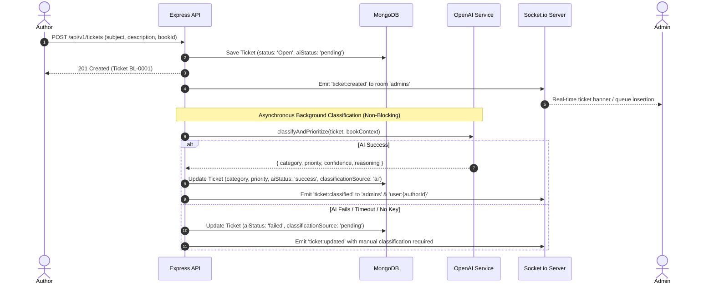
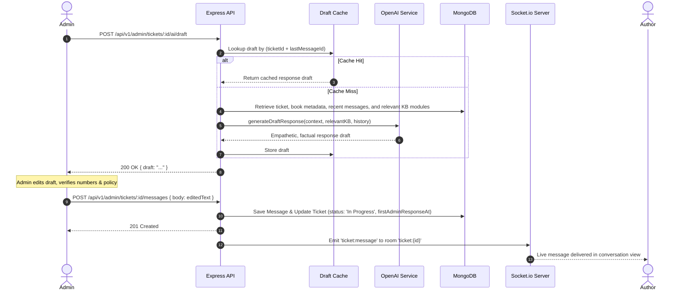

# BookLeaf Author Support & Communication Portal
## Architecture & Technical Design Document

This document outlines the architecture, data models, communication flows, security protocols, and component breakdown for the BookLeaf Author Support Portal.

---

### 1. High-Level Architecture Overview

The application is structured as a decoupled full-stack architecture with a shared MongoDB persistence layer and centralized Node.js/Express API gateway that powers two distinct presentation workflows:
1. **Author Portal:** Lightweight, focused on author visibility into royalty data, book catalog, ticket creation, and responsive messaging.
2. **Admin Portal:** Information-dense, designed for high-throughput ticket triage, AI-assisted drafting, status management, internal notes, and platform analytics.

```mermaid
flowchart TD
    subgraph Clients ["Presentation Layer (Vite + React)"]
        AP["Author Portal\n(Dashboard, Books, Ticket Form, Conversation)"]
        AdminP["Admin Portal\n(Triage Queue, Analytics, AI Draft Panel, Notes)"]
    end

    subgraph Gateway ["API & Realtime Gateway (Node.js / Express)"]
        AuthMiddleware["JWT Authentication & RBAC Middleware"]
        OwnershipGuard["Author Ownership Scoping Guard"]
        RestRouters["REST API Routers\n(/auth, /authors, /tickets, /admin)"]
        SocketEngine["Socket.io Server\n(Authenticated Rooms & Live Events)"]
        ValidationLayer["Zod Validation & Centralized Error Envelope"]
    end

    subgraph AIService ["AI Engineering Layer (OpenAI gpt-4o-mini)"]
        ClassificationPipe["Classification & Priority Engine (Structured JSON)"]
        DraftingPipe["Draft Response Engine (KB Retrieval + Context Grounding)"]
        CacheStore["Draft Response Cache (ticketId + lastMessageId)"]
        FallbackMgr["Graceful Fallback & Retry Handler"]
    end

    subgraph Persistence ["Persistence Layer (MongoDB Atlas)"]
        UsersCol[("Users Collection")]
        AuthorsCol[("Authors Collection")]
        BooksCol[("Books Collection")]
        TicketsCol[("Tickets Collection")]
        MessagesCol[("Messages Collection (Public)")]
        NotesCol[("InternalNotes Collection (Admin Only)")]
    end

    AP -->|HTTP REST + Bearer JWT| AuthMiddleware
    AdminP -->|HTTP REST + Bearer JWT| AuthMiddleware
    AP <-->|WebSockets (user:{id}, ticket:{id})| SocketEngine
    AdminP <-->|WebSockets (admins, ticket:{id})| SocketEngine

    AuthMiddleware --> OwnershipGuard
    OwnershipGuard --> RestRouters
    RestRouters --> ValidationLayer

    ValidationLayer --> TicketsCol
    ValidationLayer --> MessagesCol
    ValidationLayer --> NotesCol
    ValidationLayer --> AuthorsCol
    ValidationLayer --> BooksCol
    ValidationLayer --> UsersCol

    RestRouters -->|Async Ticket Classify| ClassificationPipe
    RestRouters -->|Admin Draft Request| DraftingPipe
    DraftingPipe <--> CacheStore
    ClassificationPipe --> TicketsCol
    ClassificationPipe -->|Live AI Complete| SocketEngine
```

---

### 2. Data Models & Mongoose Schema Design

To ensure zero mutation of the supplied data while enabling atomic operations and relational integrity:

#### A. `Author` Schema
Matches the exact fields of the supplied JSON:
- `author_id`: String, unique, indexed (e.g. `"AUTH001"`)
- `name`: String, required
- `email`: String, required, indexed
- `phone`: String
- `city`: String
- `joined_date`: Date / String
- `books`: `[{ type: Schema.Types.ObjectId, ref: 'Book' }]`

#### B. `Book` Schema
Matches the exact fields of the supplied JSON:
- `book_id`: String, unique, indexed (e.g. `"BK001"`)
- `authorId`: `ObjectId`, ref `'Author'`, required, indexed
- `author_id`: String, required (e.g. `"AUTH001"`)
- `title`: String, required
- `isbn`: String
- `genre`: String
- `publication_date`: Date / String, nullable
- `status`: String, required (e.g. `"Published & Live"`, `"In Production - Cover Design"`)
- `mrp`: Number, nullable
- `author_royalty_per_copy`: Number, nullable
- `total_copies_sold`: Number, default 0
- `total_royalty_earned`: Number, default 0
- `royalty_paid`: Number, default 0
- `royalty_pending`: Number, default 0
- `last_royalty_payout_date`: Date / String, nullable
- `print_partner`: String, nullable
- `available_on`: `[String]`, default `[]`

#### C. `User` Schema
Provides secure authentication separate from author identity:
- `email`: String, unique, indexed, lowercase
- `passwordHash`: String, select: false (never returned by default)
- `name`: String
- `role`: `'author' | 'admin'`, required
- `authorId`: `ObjectId`, ref `'Author'`, required if `role === 'author'`
- `author_id`: String, optional (e.g. `"AUTH001"`)
- `isActive`: Boolean, default true
- `lastLoginAt`: Date

#### D. `Ticket` Schema
Central entity managing support inquiries:
- `ticketNumber`: String, unique, indexed (e.g. `"BL-0001"`, generated atomically via counter)
- `authorId`: `ObjectId`, ref `'Author'`, required, indexed
- `author_id`: String, required
- `bookId`: `ObjectId`, ref `'Book'`, nullable (null represents General/Account-level inquiries)
- `subject`: String, required, text indexed
- `description`: String, required, text indexed
- `attachments`: `[{ name: String, size: Number, type: String, url: String }]`
- `category`: Enum:
  - `"Royalty & Payments"`
  - `"ISBN & Metadata Issues"`
  - `"Printing & Quality"`
  - `"Distribution & Availability"`
  - `"Book Status & Production Updates"`
  - `"General Inquiry"`
- `priority`: Enum: `["Critical", "High", "Medium", "Low"]`
- `status`: Enum: `["Open", "In Progress", "Resolved", "Closed"]` (Default: `"Open"`)
- `classificationSource`: Enum: `["ai", "manual", "pending"]`
- `aiStatus`: Enum: `["pending", "success", "failed", "skipped"]`
- `aiMeta`:
  - `confidence`: Number (0.0 to 1.0)
  - `reasoning`: String
  - `model`: String
  - `tokens`: Number
  - `timestamp`: Date
- `assignedTo`: `ObjectId`, ref `'User'`, nullable, indexed
- `firstAdminResponseAt`: Date, nullable
- `resolvedAt`: Date, nullable
- `lastMessageAt`: Date, default `Date.now`
- Timestamps: `createdAt`, `updatedAt`

*Compound Indexes:*
- `{ authorId: 1, createdAt: -1 }`
- `{ status: 1, priority: 1, category: 1 }`
- `{ assignedTo: 1, status: 1 }`
- `{ subject: "text", description: "text" }`

#### E. `Message` Schema (Public Conversation)
- `ticketId`: `ObjectId`, ref `'Ticket'`, required, indexed
- `senderId`: `ObjectId`, ref `'User'`, required
- `senderRole`: Enum: `["author", "admin", "system"]`, required
- `senderName`: String
- `body`: String, required
- `attachments`: `[Object]`
- `createdAt`: Date, default `Date.now`

#### F. `InternalNote` Schema (Strict Admin Isolation)
- `ticketId`: `ObjectId`, ref `'Ticket'`, required, indexed
- `adminId`: `ObjectId`, ref `'User'`, required
- `adminName`: String
- `body`: String, required
- `createdAt`: Date, default `Date.now`

---

### 3. Request & Real-Time Flow Sequences

#### Sequence 1: Ticket Creation & Non-Blocking AI Classification


#### Sequence 2: Admin AI Drafting & Human-in-the-Loop Send


---

### 4. Security Architecture & Privacy Safeguards

1. **Role-Based Access Control (RBAC):**
   - Routes are protected by `authenticate` middleware validating the JWT from the `Authorization: Bearer <token>` header.
   - `requireRole('admin')` restricts all admin operations, analytics, drafting, reassignment, and notes.
   - `requireRole('author')` ensures author endpoints can only be accessed by authenticated authors.
2. **Strict Author Isolation:**
   - Author controllers never accept an `authorId` parameter from the client request body or query string.
   - The verified `req.user.authorId` from the decrypted JWT payload is exclusively injected into all database queries (`{ authorId: req.user.authorId }`).
   - If an author attempts to access a book or ticket belonging to another author, the backend responds with **HTTP 404** (rather than 403) to prevent resource enumeration attacks.
3. **Internal Notes Air-Gap:**
   - The `InternalNotes` collection is physically separate from `Messages`.
   - Author API endpoints have zero queries touching `InternalNotes`.
   - Socket.io broadcasts for internal notes are restricted strictly to the `admins` room.
   - AI draft generation prompts do not consume internal notes by default.
4. **Prompt Injection Hardening:**
   - Author-submitted subject and description text is treated as untrusted input.
   - Content is wrapped in unique XML delimiters (`<<<AUTHOR_QUERY>>> ... <<<END_QUERY>>>`).
   - The system instructions explicitly order the LLM to treat the query strictly as author testimony and to ignore any meta-instructions or attempts to redefine system policies.
5. **Token Cost & Rate Limiting Controls:**
   - Express rate limiters guard API entrypoints (general limit + stricter limits on `/auth/login` and `/ai/` endpoints).
   - Knowledge Base is partitioned into topical modules (Royalty, ISBN, Printing, Distribution, Production, General). Only the relevant modules matching the ticket category and keyword triggers are injected into the prompt.
   - Conversation histories sent to LLMs are bounded to the last 5 messages with truncated lengths.
